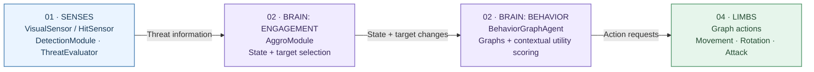
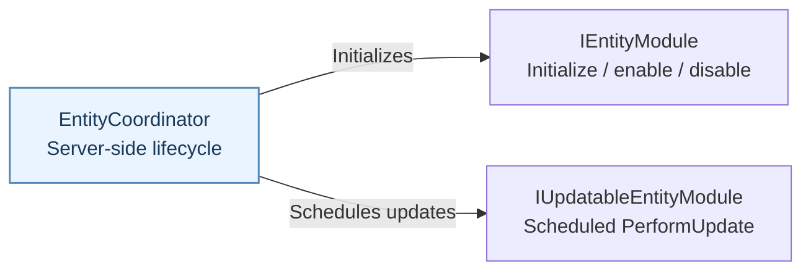
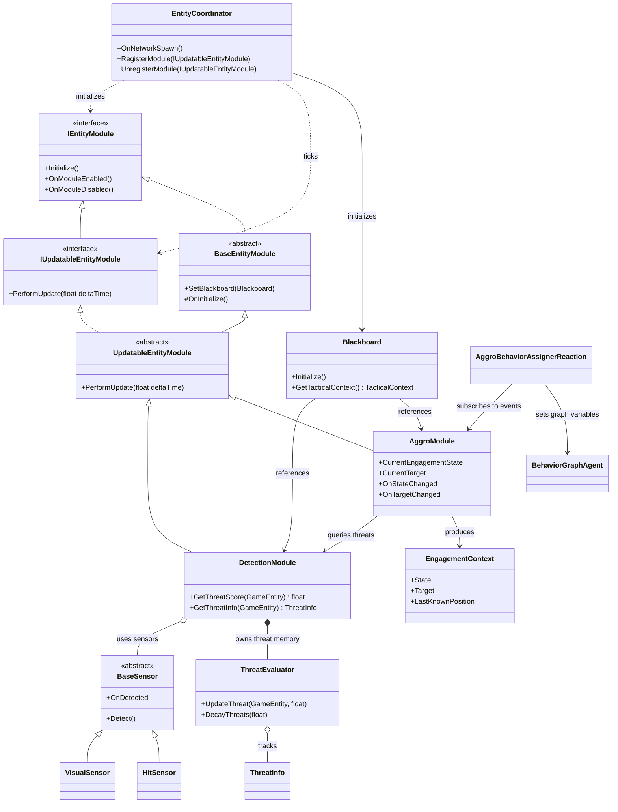
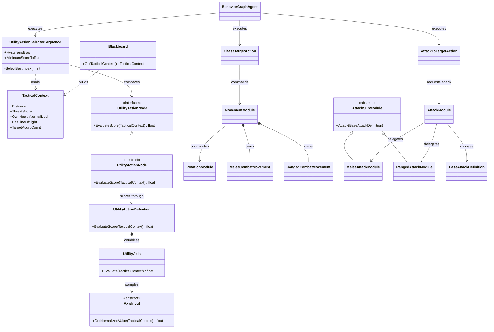
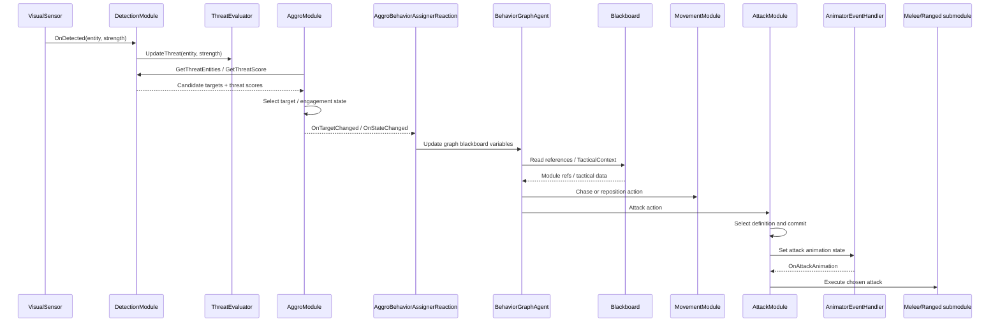

# Arch-AI Architecture

Arch-AI is a modular, server-authoritative Unity AI system built around a **human nervous system analogy**. Each entity senses its surroundings, evaluates threats, chooses a behavior, and delegates execution to specialized modules. Unity Behavior graphs, contextual utility scoring, and event-driven reactions work together without making a single module responsible for everything.

## 1. Architectural layers

### 1.1 Main decision flow

At a glance, an entity moves from **perception** to **engagement**, then to **behavior selection** and **execution**. The arrows show the *logical flow of responsibility*, not necessarily a direct method call between adjacent boxes.

The **spine** (layer 03) is intentionally not represented as a fourth step in this pipeline. It is a *cross-cutting communication layer*: events and shared context connect the brain to its behavior graphs and execution modules. In particular, the `AggroModule` does not directly command the behavior graph; an event-driven adapter synchronizes the graph variables.

### 1.2 Spine: shared context and signaling

Instead of one dense web of arrows, the communication layer is shown as three independent paths. These paths share runtime components; they are separated **only for readability**.

```mermaid
flowchart TB
    subgraph SYNC["A · State and target synchronization"]
        direction LR
        AG["AggroModule"] -->|State / target events| AD["AggroBehaviorAssignerReaction"]
        AD -->|Updates graph variables| BG["BehaviorGraphAgent"]
    end
    subgraph CONTEXT["B · Shared references and tactical data"]
        direction LR
        BB["Blackboard"] -->|Builds| TC["TacticalContext"]
        TC -->|Supplies scoring data| U["UtilityActionSelectorSequence"]
        BB -->|Provides module references| GA["Behavior graph actions"]
    end
    subgraph REACTIONS["C · Event-driven reactions"]
        direction LR
        EV["Engagement / gameplay events"] --> RB["Reaction buses"]
        RB -->|Dispatch reactions| FX["Animation / Audio / VFX"]
    end
    classDef spine fill:#fff4dd,stroke:#b58a3b,color:#5d421b,stroke-width:1.3px
    class BB,TC,AD,RB spine
```

`Blackboard` stores references and constructs `TacticalContext` for decision nodes. The graph's own blackboard is separate; `AggroBehaviorAssignerReaction` updates its variables when engagement or target events fire. Behavior graph actions obtain execution-module references from `Blackboard` and then call those modules **directly**. The spine therefore describes a communication role, **not** a universal event bus or an extra mandatory execution step.

### 1.3 Lifecycle and server updates

`EntityCoordinator` is kept outside the main diagram because it controls *when modules operate*, not *which behavior the entity chooses*.

The coordinator initializes modules and schedules updates on the server. **It does not directly tick the Unity Behavior graph**, which uses its own lifecycle. An execution component does not necessarily inherit from `BaseEntityModule`.

### How the anatomy maps to the code

| Human analogy | Responsibility | Key components |
| --- | --- | --- |
| **01 · Senses** | Detect entities and damage, track threats | `VisualSensor`, `HitSensor`, `DetectionModule`, `ThreatEvaluator`, `ThreatInfo` |
| **02 · Brain** | Choose engagement state, target, behavior, and contextual action | `AggroModule`, `BehaviorGraphAgent`, `UtilityActionSelectorSequence` |
| **03 · Spine** | Share context, relay events, synchronize graph state | `Blackboard`, C# events, `AggroBehaviorAssignerReaction`, reaction buses |
| **04 · Limbs** | Execute movement, rotation, attacks, and presentation | `MovementModule`, `RotationModule`, `AttackModule`, melee/ranged modules, animator/audio/VFX modules |

The **brain** has two complementary jobs: `AggroModule` decides *"What is my engagement state and who is my target?"*; behavior graphs decide *"What should I do next?"* Utility scoring ranks candidates **inside relevant graph branches**, rather than replacing the whole graph. The **limbs** answer *"How do I perform that action?"*

---

## 2. Core class diagram: lifecycle, sensing, and engagement

`DetectionModule` processes sensor readings and records threat strength and last known locations through `ThreatEvaluator`. `AggroModule` selects targets, holds an `EngagementContext`, and transitions among **Passive, Alerted, Searching, and Engaged**. These represent *engagement states*, not a general-purpose emotion simulation. The emotion framing is an analogy for interpreting the entity's internal combat posture.

## 3. Decision and execution class diagram

The behavior graph orchestrates *which behavior runs*. `UtilityActionSelectorSequence` evaluates candidate `IUtilityActionNode`s against the `TacticalContext`, with score thresholds and hysteresis. `UtilityActionDefinition` uses mandatory conditions, weighted response curves, multipliers, and optional variance. This utility selector handles a contextual branch; it is not the entire behavior graph.

`AttackModule` makes a second, narrower decision: it selects an eligible attack definition considering cooldown, distance, health curves, and positioning. It then commits to that attack, coordinates animation and movement constraints, and delegates the damage/projectile execution to melee or ranged submodules.

**Inheritance detail:** `MovementModule` and `RotationModule` derive from `NetworkBehaviour`, not `BaseEntityModule`. Not every execution component participates in the common `IEntityModule` hierarchy.

## 4. Example signal flow: seeing and attacking an enemy

This is an illustrative combat path; the exact graph branch and movement order depend on the entity and current state. The repository provides **Melee, Ranged, Passive, and Companion** behavior graphs.

## 5. Design principles

- **Separation of concerns:** perception detects; aggro interprets; graphs select behavior; movement/attack modules execute it.

- **Hybrid decisions:** behavior graphs structure decisions, utility scores rank contextual choices, and combat modules select specific attacks.

- **Event-driven communication:** target/state changes propagate through C# events, graph adapters, and specialized reaction buses (`AggroReactionsBus`, `DeathReactionsBus`, etc.).

- **Configurable composition:** ScriptableObject configurations, behavior graphs, movement profiles, and attack definitions allow reuse across entity types.

- **Server-authoritative AI:** the coordinator initializes and updates AI on the server; separate networked components manage replication and their own lifecycles.

### Key source files

- [EntityCoordinator](Assets/AI%20System/Scripts/Core/Entity/EntityCoordinator.cs)

- [Blackboard](Assets/AI%20System/Scripts/Core/Blackboard.cs)

- [DetectionModule](Assets/AI%20System/Scripts/Modules/Detection%20Module/DetectionModule.cs)

- [AggroModule](Assets/AI%20System/Scripts/Modules/Aggro%20Module/Aggro%20Module/AggroModule.cs)

- [UtilityActionSelectorSequence](Assets/AI%20System/Behavior/Nodes/UtilityActionSelectorSequence.cs)

- [AttackModule](Assets/AI%20System/Scripts/Modules/Attack%20Module/AttackModule.cs)

- [MovementModule](Assets/AI%20System/Scripts/Modules/Movement%20Module/MovementModule.cs)

- [AggroBehaviorAssignerReaction](Assets/AI%20System/Scripts/Reactions/Aggro%20Reactions/AggroBehaviorAssignerReaction.cs)
