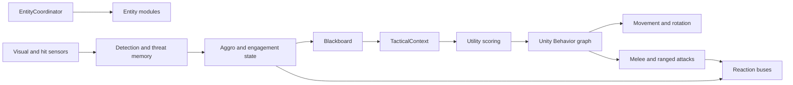

# Arch-AI

A modular Unity AI system combining behavior graphs, utility scoring, threat memory, and melee and ranged combat. This repository contains the `Assets/AI System` folder exported from a larger game; it is not a standalone Unity project.

## Architecture

`EntityCoordinator` initializes the entity and ticks its updateable modules on the server. `Blackboard` holds the entity's shared references and produces a `TacticalContext` for utility scoring. Behavior graph actions issue commands to the modules; reaction buses translate state changes into animation, audio, effects, and other game responses.



The existing component boundaries keep decisions, navigation, attack execution, and presentation separate. ScriptableObject configurations provide entity settings, movement profiles, attack definitions, utility response curves, and faction relationships.

## Systems

- **Detection and aggro:** visual and hit sensors, decaying threat memory, target selection, engagement states, investigation, and search behavior.
- **Utility scoring:** mandatory gates, weighted response curves, multiplicative scores, and optional random variance.
- **Combat:** attack commitment and cooldowns, collider-based melee range, melee approach/withdrawal, ranged positioning, and animation event relays.
- **Movement:** NavMesh navigation, movement profiles, ground fitting integration, facing policies, strafing, flanking, and fleeing.
- **Companions and taming:** autonomous/action commands, companion states, server-validated taming, ownership, progress credit, and effects.
- **Reactions and spawning:** aggro, stun, death, dissolve, loot, spawn anchors, and spawn zone management.

## Source layout

```text
Assets/AI System/
├── Behavior/       Actions, conditions, enums, nodes, and saved graphs
├── Scripts/
│   ├── Core/       Entities, module contracts, blackboard, configuration, taming
│   ├── Modules/    Aggro, attacks, commands, detection, movement, visual modules
│   ├── Tactics/    Tactical context and utility axis inputs
│   ├── Reactions/  Event-driven presentation and game responses
│   ├── Integrations/Stats/
│   ├── Utils/
│   └── World/
├── Spawners/
├── Data/
├── Prefabs/
├── Resources/
└── Tests/Editor/
```

AI code lives under `Artifika.AI` and its existing subnamespaces. Editor tooling and tests use dedicated namespaces. Fields, locals, and parameters use camelCase. Public APIs, Unity callbacks, animation event names, and Behavior graph field names retain their established names.

## Assemblies and dependencies

`Artifika.AI.Utility.asmdef` contains the utility scoring model. The `.asmref` in `Scripts/Tactics` includes the tactical context and axis inputs in that same assembly. This boundary has no dependency on the host game's entity, combat, or UI implementations. Odin inspector attributes remain a dependency, supplied by the existing precompiled Odin assembly.

The remaining runtime and editor code compiles in Unity's predefined assemblies. It directly uses gameplay code absent from this export; putting it in a root asmdef would require those host dependencies to move into compatible assemblies first. An asmdef cannot reference `Assembly-CSharp`; see [Unity's assembly reference rules](https://docs.unity3d.com/6000.0/Documentation/Manual/assembly-definitions-referencing.html).

The source uses these Unity packages and third-party libraries:

| Dependency | Usage |
| --- | --- |
| Unity Behavior and Properties | Behavior graphs, custom nodes, property bags |
| Netcode for GameObjects and Collections | Server authority, RPCs, replicated state |
| TextMeshPro and Michsky Reach UI | Host boss health presentation tests |
| Odin Inspector | Inspector configuration and editor tools |
| DOTween | Presentation animation |
| More Mountains Feedbacks | Audio and visual feedback |
| Highlight Plus | Tameable entity highlighting |
| Host game code | Health/damage, projectiles, stats, inventory, player input/state, ground fitting, music, registries, and events |

No package versions are pinned in this export. Use the compatible versions from the original game project and preserve the supplied `.meta` files when importing.

## Integration

1. Import `Assets/AI System` into the host Unity project with its gameplay dependencies and third-party libraries.
2. Configure entity references on `Blackboard`, `EntityCoordinator`, and the relevant modules. The Blackboard inspector's **Gather References** tool can populate component references.
3. Assign the entity, movement, combat, and utility configurations and the appropriate Behavior graph.
4. Keep the `FactionRelations` asset under `Resources` and configure the damage permission matrix.
5. Connect the host interaction flow to `TamingController.TryTameServer(clientId, playerObject, target)` on the server. Taming validates the connected player, range, current player permissions, and the living, stunned, tameable target before conversion.
6. Check server/client behavior, attack animation events, spawn ownership, and companion/taming integration in the host project.

Namespace and utility assembly migrations use `MovedFrom`; renamed serialized fields use `FormerlySerializedAs`. Saved graph and asset type references are migrated alongside the source. Graph node IDs and existing script GUIDs are retained. External host callers may need updated `using Artifika.AI;` directives when importing the namespaced types. Named arguments to `SetBlackboard` now use `newBlackboard:` instead of `_blackboard:`.

## Verification

The existing EditMode tests cover melee combat, hold-ground behavior, ranged positioning, and boss health presentation. Run them with Unity Test Runner in the host project after import. Boss health tests require the host game's health and UI implementations.

This export has no `Packages/manifest.json`, `ProjectSettings/ProjectVersion.txt`, or standalone build configuration, so it cannot run the Unity test suite by itself.
