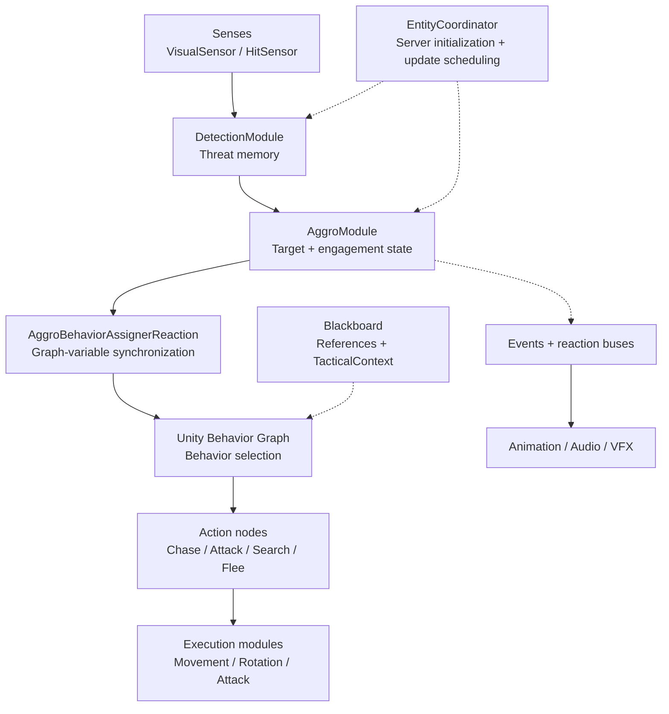

# Arch-AI

**A modular, server-authoritative AI system for Unity.**

Arch-AI combines **Unity Behavior graphs**, **utility-based decisions**, and **specialized gameplay modules** to support creatures with different combat styles and behaviors. It was developed within a larger game project and is shared here as a source-code showcase, not as a standalone Unity package.

The architecture is inspired by the human nervous system: **senses** gather information, the **brain** decides what to do, a **spinal communication layer** carries context and signals, and the **limbs** execute actions. The goal is to keep *perception, decision-making, and execution* independent enough to reuse across different entities.

## Architecture at a glance



The *spine* is a design analogy, not a single central event bus. Communication happens through shared component references (`Blackboard`), C# events, graph-variable adapters, and specialized reaction buses. `EntityCoordinator` handles initialization and scheduled updates rather than making AI decisions.

**[Explore the architecture, class diagrams, and a combat sequence →](ARCHITECTURE.md)**

## Key systems

### Perception and threat memory

`VisualSensor` and `HitSensor` feed `DetectionModule`, which filters observations and tracks threats through `ThreatEvaluator`. Threats have scores, last-known positions, and memory that decays over time, allowing agents to investigate or search after losing sight of a target.

### Aggro and engagement state

`AggroModule` interprets threat information and handles **target selection** and transitions between `Passive`, `Alerted`, `Searching`, and `Engaged`. It also emits events when the target or state changes. This is the entity's *response to a situation*, separate from the choice of a specific action.

### Behavior graphs

Unity Behavior graphs orchestrate high-level behaviors such as **chasing, attacking, searching, fleeing, and following an owner**. The repository includes separate **Melee**, **Ranged**, **Passive**, and **Companion** graphs. Custom action and condition nodes interact with modules rather than implementing all movement and combat logic inside the graph.

### Utility scoring

Within the behavior graph, `UtilityActionSelectorSequence` can select a contextual action by evaluating a `TacticalContext` built from distance, health, line of sight, threat, and other inputs. `UtilityActionDefinition` assets define **mandatory conditions, weighted response curves, multipliers, and optional variance**. A hysteresis bias helps avoid rapid switching between similarly scored actions.

Utility scoring **complements** the behavior graph; it does not replace the full graph. `AttackModule` also performs its own more focused selection among eligible attack definitions.

### Movement and combat

`MovementModule` handles navigation and melee/ranged positioning, while `RotationModule` controls facing. `AttackModule` manages attack selection, cooldowns, and commitment, then delegates execution to `MeleeAttackModule` or `RangedAttackModule`. Animation events determine when the actual hit or projectile action occurs.

### Reactions and companions

Event-driven reaction buses connect gameplay state changes to **animation, audio, visual effects, death handling, and other responses**. Companion systems add owner commands, companion states, and behavior-graph synchronization. Taming support is integrated with the larger game's gameplay systems.

## Design principles

- **Separation of concerns:** detect, interpret, decide, and execute in distinct components.
- **Composable behavior:** reuse modules while changing graphs, configurations, and attack definitions.
- **Data-driven tuning:** configure movement, combat, aggro, and utility scoring with ScriptableObjects.
- **Server authority:** AI updates and gameplay decisions run on the server, with networked components handling synchronization.
- **Extensible reactions:** respond to state changes without putting presentation logic into decision code.

## Repository structure

```text
Assets/AI System/
├── Behavior/         # Behavior graph assets, actions, conditions, utility nodes
├── Scripts/
│   ├── Core/         # Entity lifecycle, blackboard, module abstractions, configuration
│   ├── Modules/      # Detection, aggro, movement, attack, commands
│   ├── Tactics/      # Tactical context and utility inputs
│   ├── Reactions/    # Event-driven gameplay and presentation reactions
│   └── World/        # Companion-related world interactions
├── Data/             # ScriptableObject assets and profiles
├── Spawners/         # Spawn management
└── Tests/Editor/     # EditMode tests
```

## Integration notes

This repository contains the AI source and assets **extracted from a larger Unity project**. It has no standalone `Packages/manifest.json` or complete host-game implementation, so it is **not directly runnable as-is**.

The code depends on **Unity Behavior**, **Netcode for GameObjects**, **Odin Inspector**, and other gameplay and presentation integrations. Host-game systems such as health/damage, projectiles, stats, and ground fitting must also be supplied. Existing EditMode tests are intended to run in the original host project.

For the full system breakdown, important classes, communication patterns, and execution flow, see **[ARCHITECTURE.md](ARCHITECTURE.md)**.
